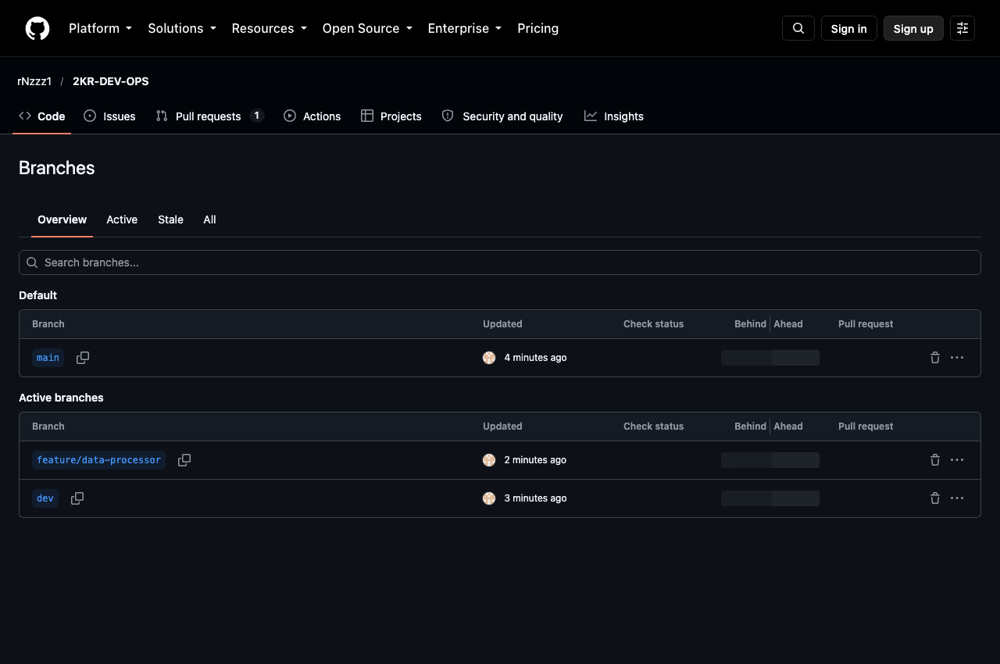
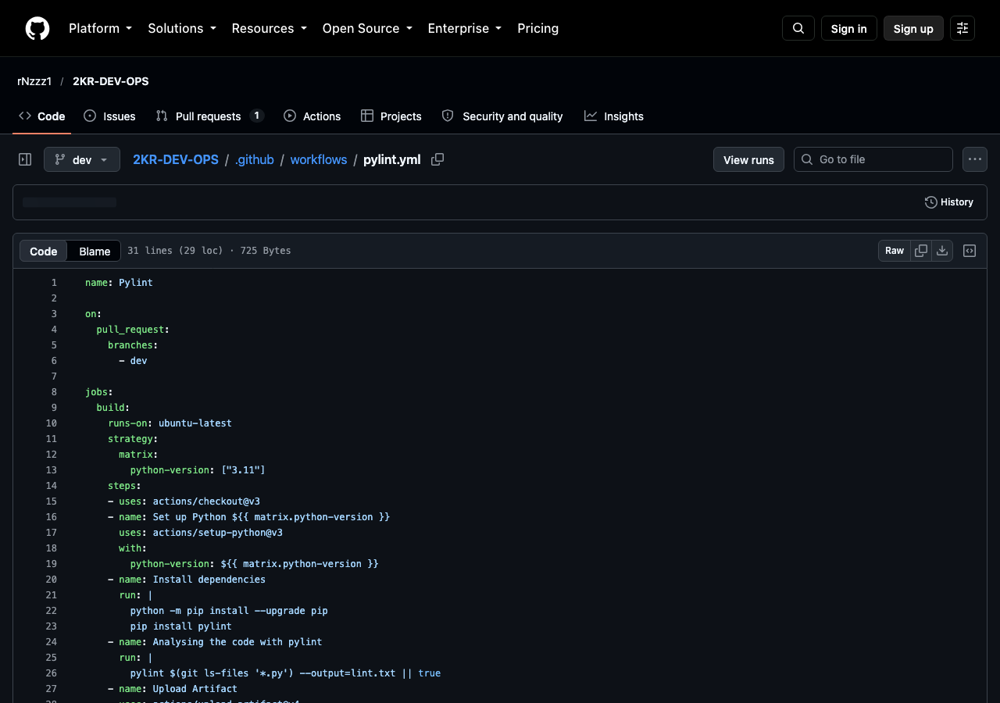
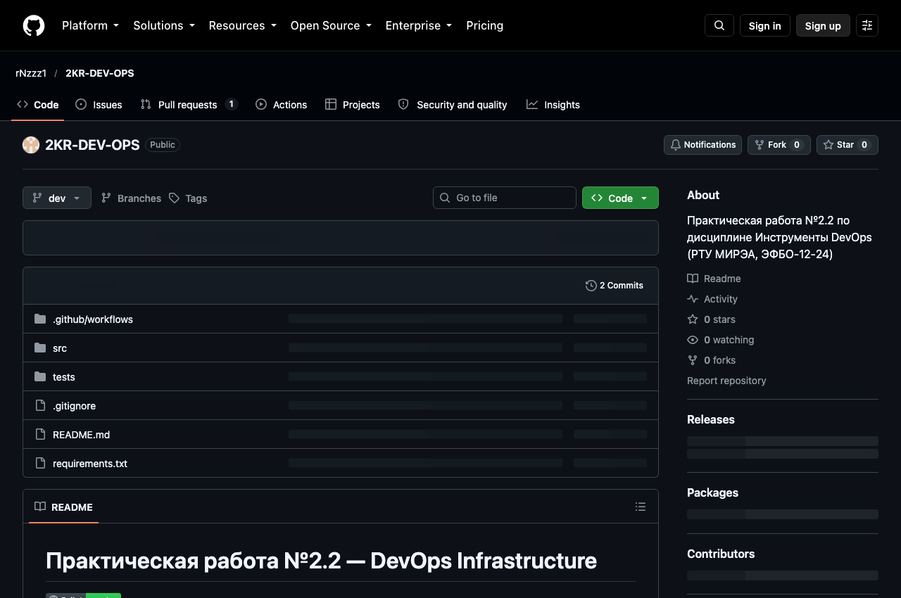
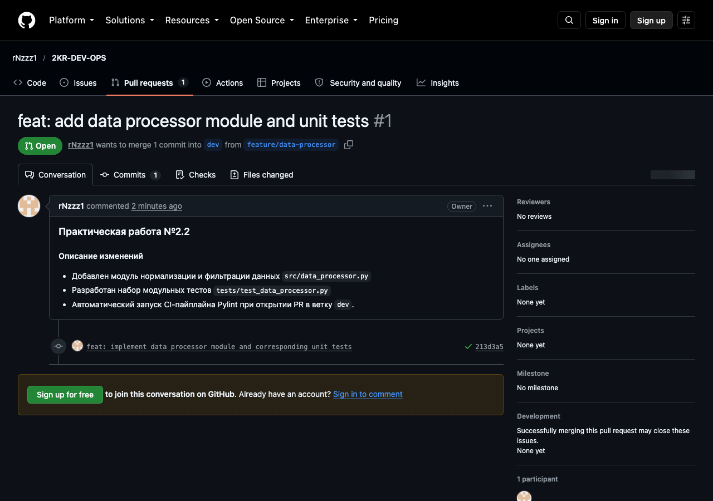
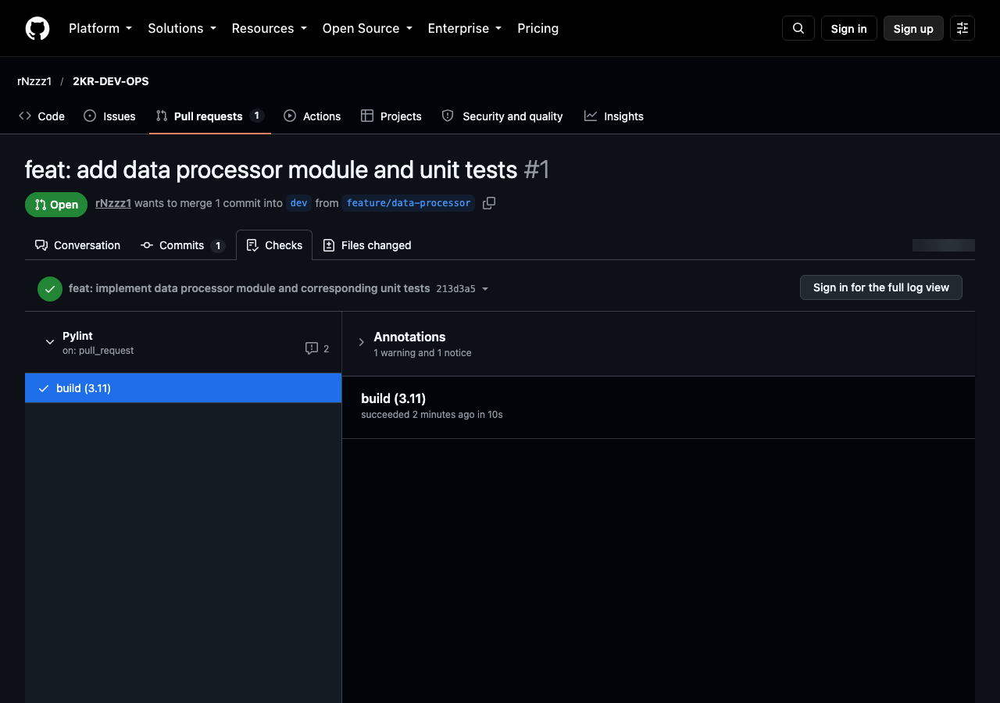
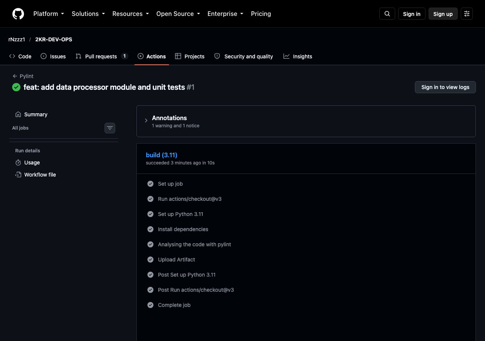
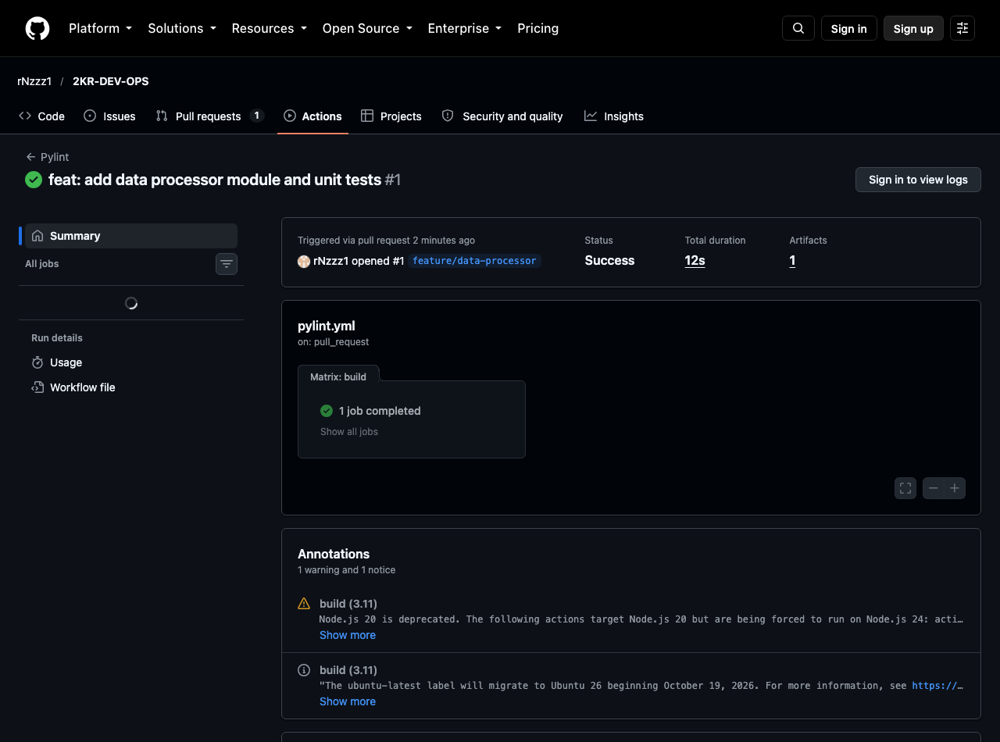

# Отчёт по практической работе № 2.2
## Тема: Задание основ инфраструктуры проекта: Git-ветвление и автоматизация CI-пайплайна в GitHub Actions

- **Дисциплина:** Инструменты DevOps
- **ВУЗ:** РТУ МИРЭА, ИПТИП, Кафедра индустриального программирования
- **Выполнил:** студент гр. ЭФБО-12-24 Узунян Овсеп Норайрович
- **Проверил:** преподаватель Гиматдинов Дамир Маратович
- **Репозиторий проекта:** [rNzzz1/2KR-DEV-OPS](https://github.com/rNzzz1/2KR-DEV-OPS)
- **Pull Request #1:** [feat: add data processor module and unit tests](https://github.com/rNzzz1/2KR-DEV-OPS/pull/1)
- **GitHub Actions Run:** [Pylint #38214163841](https://github.com/rNzzz1/2KR-DEV-OPS/actions/runs/38214163841)

---

## 1. Цель работы

1. Задать основы инфраструктуры для проекта по разработке программного обеспечения (ПО).
2. Освоить практику организации ветвления в распределенной системе контроля версий Git (`main`, `dev`, `feature/`).
3. Настроить непрерывную интеграцию (CI) с использованием GitHub Actions для автоматической статической проверки исходного кода (Pylint).
4. Сконфигурировать пайплайн на автоматический запуск при создании Pull Request в целевую ветку `dev`.
5. Проверить корректность отработки CI-пайплайна, сборку артефактов проверки и прохождение статусных проверок (Checks) перед слиянием кода.

---

## 2. Пошаговое выполнение

### Шаг 1. Создание ветки `dev` в локальном репозитории
```bash
git branch dev
git checkout dev
git status
```

### Шаг 2. Отправка ветки `dev` на удаленный репозиторий
```bash
git push -u origin dev
```


### Шаг 3. Настройка workflow Pylint для ветки `dev`
Создан файл `.github/workflows/pylint.yml`:
```yaml
name: Pylint

on:
  pull_request:
    branches:
      - dev

jobs:
  build:
    runs-on: ubuntu-latest
    strategy:
      matrix:
        python-version: ["3.11"]
    steps:
    - uses: actions/checkout@v3
    - name: Set up Python ${{ matrix.python-version }}
      uses: actions/setup-python@v3
      with:
        python-version: ${{ matrix.python-version }}
    - name: Install dependencies
      run: |
        python -m pip install --upgrade pip
        pip install pylint
    - name: Analysing the code with pylint
      run: |
        pylint $(git ls-files '*.py') --output=lint.txt || true
    - name: Upload Artifact
      uses: actions/upload-artifact@v4
      with:
        name: lint.txt
        path: lint.txt
```

Фиксация и отправка в репозиторий:
```bash
git add .github/workflows/pylint.yml
git commit -m "ci: add pylint workflow configured for PR to dev branch"
git push origin dev
```


### Шаг 4. Создание новой ветки от ветки `dev`
```bash
git checkout -b feature/data-processor
```

### Шаг 5. Внесение изменений и отправка на GitHub
Разработан модуль нормализации и валидации данных `src/data_processor.py` и набор тестов `tests/test_data_processor.py`.
```bash
git add .
git commit -m "feat: implement data processor module and corresponding unit tests"
git push -u origin feature/data-processor
```


### Шаг 6. Создание Pull Request в ветку `dev`
Для ветки `feature/data-processor` открыт Pull Request #1 в ветку `dev`:


### Шаг 7. Проверка корректности работы CI-пайплайна
Пайплайн Pylint отработал автоматически при создании PR и завершился со статусом **Success** (10.00/10):




Содержимое выгруженного артефакта `lint.txt`:
```text
------------------------------------
Your code has been rated at 10.00/10
```

---

## 3. Заключение

Инфраструктура проекта успешно развернута: настроена схема ветвления, реализован CI-пайплайн проверки кода с помощью Pylint в GitHub Actions, проверено автоматическое исполнение проверок при создании Pull Request в ветку `dev`. Все проверки успешно пройдены.
